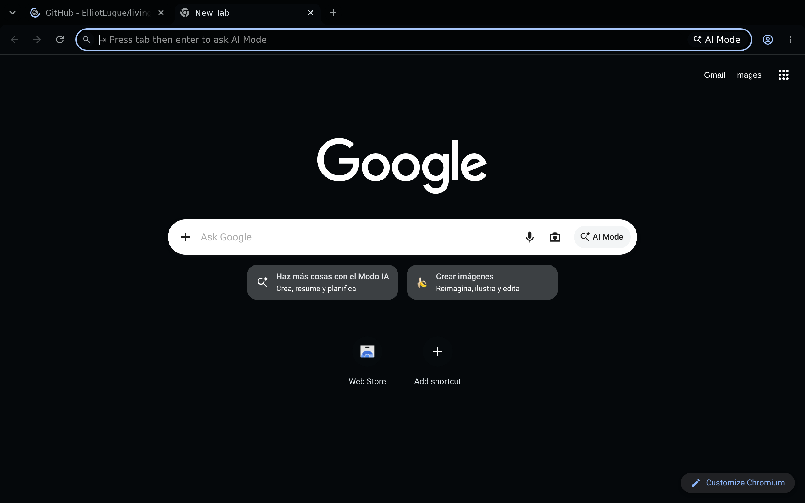
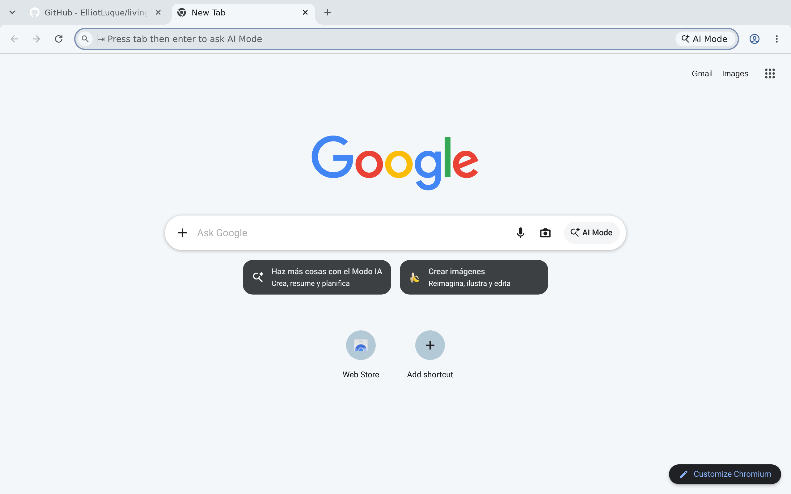

<!-- living-code-readme:1 -->
# 🌐 Living Code for Chrome, Brave and Chromium

**Calm slate. Living color.** Living Code for Chrome, Brave and Chromium. Repository-owned theme files, installation instructions and Night and Paper.

[Installation](#installation) · [Flavors](#flavors) · [Configuration](#configuration) · [All ports](https://github.com/living-code-theme)

## Previews

<table data-lc-flavors>
<tr>
<td width="50%" valign="top">
<strong>Night</strong> Dark · full palette  

</td>
<td width="50%" valign="top">
<strong>Paper</strong> Light · near-white slate  

</td>
</tr>
</table>

Select any preview to view the image at full size.

## Installation

Choose **Night** for a dark browser or **Paper** for a light one. They are Manifest V3 themes for Chrome and Chromium; Brave installs Chrome themes too. Vivaldi does not apply Chrome themes, and Edge, Opera and Arc have not been tested.

1. **Release zip:** download `living-code-chrome-night.zip` or `living-code-chrome-paper.zip` from the latest [GitHub release](https://github.com/living-code-theme/chrome/releases/latest) and unzip it. Open `chrome://extensions`, turn on **Developer mode**, click **Load unpacked** and select the folder. (From a checkout, select `living-code-night` or `living-code-paper`.)
2. **Chrome Web Store, once listed:** Neither theme is listed yet. When they are, search for **Living Code Night** or **Living Code Paper** and click **Add to Chrome**.

To switch themes, install the other one, or use **Settings → Appearance → Reset to default**.

## Flavors

Expand a flavor for its full-size preview and activation instructions.

<strong>Night</strong> · Dark · full palette

Load the `living-code-night` folder using *chrome://extensions → Developer mode → Load unpacked*, or the matching store theme when listed.

<strong>Paper</strong> · Light · near-white slate

Load the `living-code-paper` folder using *chrome://extensions → Developer mode → Load unpacked*, or the matching store theme when listed.

## Configuration

See [Chrome, Brave and Chromium's documentation](https://chromewebstore.google.com/category/themes) for application settings and reload behavior. The activation instructions above identify each supported flavor; keep your other application configuration.

## Compatibility

Manifest V3 themes for Chrome, Chromium and Brave. Only Night and Paper ship. Vivaldi does not apply Chrome themes; Edge, Opera and Arc have not been tested.

## Contributing

Found a problem? [Open an issue](https://github.com/living-code-theme/chrome/issues/new/choose) with the app version, the flavor and a screenshot. Want Living Code somewhere else? [Request a port](https://github.com/living-code-theme/core/issues/new?template=port-request.yml).

Pull requests are welcome. Keep this README, `port.json` and `images/` in sync, and use real screenshots of the app, never mockups.

🦎 **One chameleon, many habitats.** Part of [Living Code](https://github.com/living-code-theme).

## License

[MIT](LICENSE) © Elliot Luque
